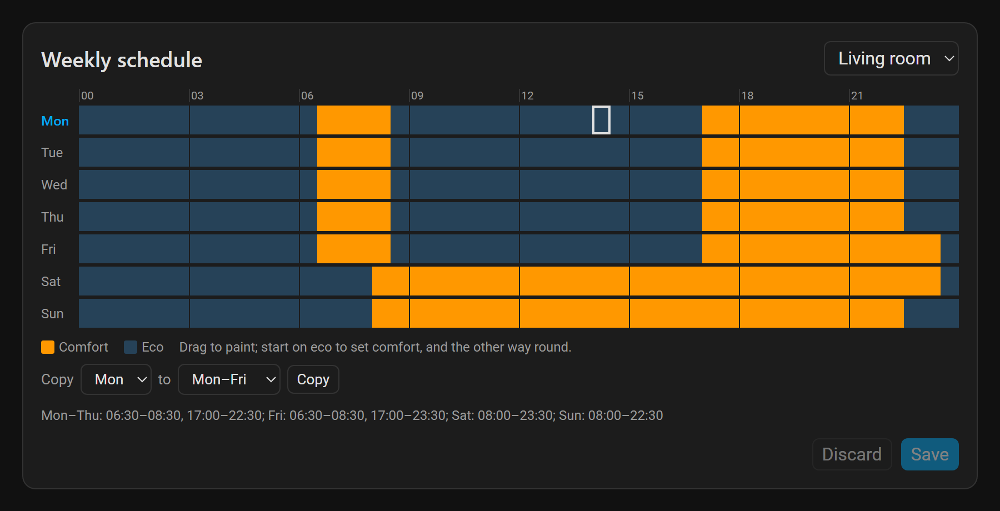
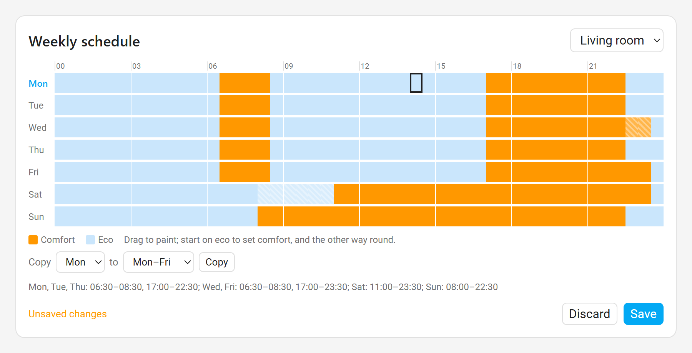

# Watts Proxy for Home Assistant

Home Assistant add-on for the **Watts Vision BT-CT02-RF** central unit (underfloor heating
thermostats). It keeps the Watts cloud and app working, answers locally when the cloud
is down, and gives Home Assistant full local control of the thermostats.



- **Climate entities:** off / heat / auto, presets eco, boost (with configurable
  duration) and away (frost protection), setpoints, heating or idle.
- **Weekly schedules** editable from Home Assistant, as text or with a graphical card.
- **Cloud outage resilient:** if the Watts cloud does not answer, the proxy answers the
  central unit itself; nothing stops working.
- **Health:** communication with the central unit, silent thermostats, failed commands
  and an event entity for notifications.
- **No radio, no firmware changes:** it works at the network level (a DNS rewrite).
  Undo it by removing the rewrite.

> **Status: beta.** Tested with one BT-CT02-RF (firmware 03.63) and BT-D03-RF
> thermostats, in daily use since November 2026. Other models or firmware may use different fields.
> Reports from other installations are very welcome.

## Install

[](https://my.home-assistant.io/redirect/supervisor_add_addon_repository/?repository_url=https%3A%2F%2Fgithub.com%2FVictor-DevLabs%2Fha-watts-proxy)

Or: *Settings → Add-ons → Add-on store → ⋮ → Repositories* and add
`https://github.com/Victor-DevLabs/ha-watts-proxy`.

Then follow the [documentation](watts_proxy/DOCS.md): it needs the Mosquitto add-on and
a DNS rewrite for the central unit (for example with AdGuard Home).

## Schedule card

`card/watts-schedule-card.js` is a graphical editor for the weekly schedules: paint
comfort/eco by dragging, copy days, save and get confirmation from the central unit.
English and Spanish, following the language of Home Assistant.



1. Copy `card/watts-schedule-card.js` to `/config/www/`.
2. *Settings → Dashboards → ⋮ → Resources → Add resource*:
   `/local/watts-schedule-card.js`, type *JavaScript module*.
3. Add the card *Watts: weekly schedule*, or in YAML:

   ```yaml
   type: custom:watts-schedule-card
   entity: text.watts_zone_1_schedule   # optional: without it, a zone selector
   names:                               # optional
     text.watts_zone_1_schedule: Living room
   ```

When you update the file, change the resource URL (e.g. `?v=0.2.0`) so browsers do not
keep the old version.

## Help wanted

- **Low battery:** which local field carries it? The add-on warns when an unidentified
  field changes; please open an issue if it happens to you.
- **Cooling** (floor cooling in summer): which field switches heat/cool?
- **Other central units or firmware versions:** do they work? Please share anonymized
  logs (remove the MAC address).

## Development

Pure Python 3 standard library, no dependencies. Tests:

```
python -m unittest discover -s tests
node --test tests/card.test.js
```

`tools/card-demo.html` shows the card with made-up data, without Home Assistant
(`?theme=light|dark&lang=en|es&draft=1`). The screenshots are taken from it.

## Credits

Built on the protocol work shared in
[pwesters/watts_vision#38](https://github.com/pwesters/watts_vision/issues/38), especially
by Fl0kkie ([watts-vision-local](https://github.com/Fl0kkie/watts-vision-local)).

Not affiliated with or endorsed by Watts. MIT license.
